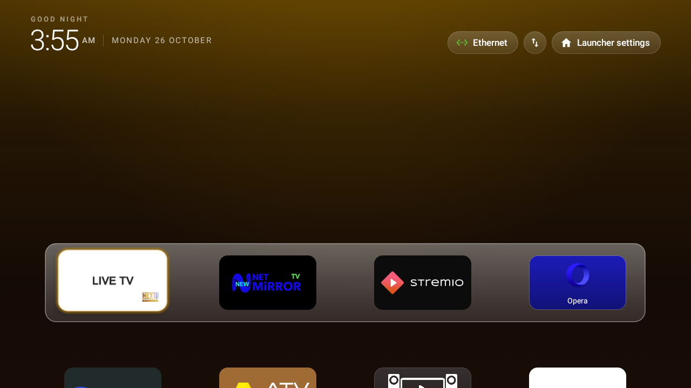

# 📺 CleanYourTV Launcher for Android TV

[-2ea44f?style=for-the-badge&logo=android)](release/CleanYourTV.apk)

[-3DDC84?style=flat&logo=android)](https://developer.android.com)
[](https://www.oracle.com/java/)
[](https://gradle.org)
[](LICENSE)
[]()

A blazing-fast, distraction-free, ultra-lightweight launcher tailored for Android TV devices and set-top boxes. Specially tuned and optimized for low-resource Amlogic TV hardware (e.g., WorldLink NetTV Box / GIEC GX1001 / p212_1113 running Android 7.1.2 Nougat) as well as modern Android TV / Google TV platforms.

> **📦 Quick Download**: Grab the latest pre-built APK directly from [release/CleanYourTV.apk](release/CleanYourTV.apk) or via [GitHub Releases](https://github.com/prabeshgupta/cleanyourtv/releases).

---

## 📸 Screenshots

| Clean Home Screen (Dock Low by Default) | Launcher Settings (Clean & Bloat-Free) |
| :---: | :---: |
|  |  |

| Scrolled Settings (Animations & Effects Only) | Interactive Custom DP Stepper Dialog |
| :---: | :---: |
|  |  |

---

## ✨ Key Features & Optimizations

- 🚀 **Zero-Jump Cold Boot Engine**:
  - The dock sits low at the bottom of the screen immediately upon boot.
  - Fixes the classic Android TV RecyclerView "jump bug" where the dock would start in the upper half of the screen and abruptly snap down only after the user pressed a D-Pad key.
- 🎛️ **On-Screen Custom DP Stepper**:
  - Directly customize the **Dock Shelf Padding** and **Bottom Gap** right from the TV remote.
  - Interactive stepper dialog with `[-10]`, `[-2]`, direct number entry, `[+2]`, and `[+10]` controls — no need to edit configuration XMLs or recompile.
- 🧹 **Distraction-Free Minimalist UI**:
  - Aligned time & date header with status indicators.
  - Removed duplicate text badges above the dock during app switching.
  - Stripped unnecessary bloat from the settings menu (removed wallpaper picker, theme follower, device setting duplicates, and home reset buttons).
- ⚡ **Ultra-Low Memory & CPU Footprint**:
  - Release APK under **3 MB**.
  - Optimized with R8 full-mode shrinking and resource stripping.
  - Stripped unnecessary Kotlin metadata from dependencies, saving memory on 1GB RAM set-top boxes.
- 🔄 **Desugared Modern Java on Android 7 (API 25)**:
  - Uses `desugar_jdk_libs` to bring modern `java.time` APIs seamlessly to older Nougat firmware.

---

## 📂 Repository Structure

```
.
├── .github/workflows/          # GitHub Actions CI/CD pipeline
│   └── build.yml               # Automated APK compilation on push/PR
├── app/                        # Main Android application module
│   ├── src/main/java/com/gathin/tvhome/
│   │   ├── MainActivity.java           # Core launcher logic & RecyclerView focus
│   │   ├── LauncherSettingsActivity.java # Interactive settings & custom DP steppers
│   │   ├── AppModel.java               # Installed apps loader & filter
│   │   └── Config.java                 # SharedPreferences persist manager
│   ├── src/main/res/                   # Layouts, drawables, fonts, strings
│   └── build.gradle                    # App build config (minify, desugaring)
├── public/                     # High-definition lossless screenshots
│   ├── Home.png                        # Home screen
│   ├── Launcher 1.png                  # Settings screen (top)
│   ├── Launcher 2.png                  # Settings screen (bottom)
│   └── Launcher 3.png                  # Custom stepper dialog
├── build.bat                   # 1-Click Windows build script
├── install_to_tv.bat           # 1-Click ADB Wi-Fi/Ethernet deploy script
├── capture_tv_screenshot.py    # Raw framebuffer dumper for headless/Amlogic boxes
├── build.gradle                # Root project build script
├── settings.gradle             # Project settings
└── README.md                   # Project documentation
```

---

## 🛠️ Prerequisites

To build this project from source, you need:
- **JDK**: Java 17 or higher
- **Android SDK**: API 36 / Build-Tools 36.0.0 (Supports targetSdk 34, minSdk 25)
- **Gradle**: 9.8.1 (included via Gradle Wrapper `gradlew`)
- **ADB**: (Optional) For network installation to your TV box

---

## 🔨 Building the Project

### Clone Repository

```bash
git clone https://github.com/prabeshgupta/cleanyourtv.git
cd cleanyourtv
```

### Using Gradle Wrapper (Cross-Platform)

```bash
# On Linux / macOS:
./gradlew :app:assembleRelease

# On Windows PowerShell:
.\gradlew.bat :app:assembleRelease
```

### Using 1-Click Build Script (Windows)

Simply double-click `build.bat` or run:
```cmd
build.bat
```

The compiled release APK will be generated at:
```
app/build/outputs/apk/release/app-release.apk
```

---

## 📲 Installing to Android TV over ADB

1. Make sure your Android TV Box and computer are on the same Wi-Fi / Ethernet network.
2. Enable **Developer Options** and **USB/Network Debugging** on your TV.
3. Run the automated install script:

```cmd
install_to_tv.bat [TV_IP_ADDRESS]
```

*(You can pass your TV's IP address directly, e.g. `install_to_tv.bat <TV_IP_ADDRESS>`, or simply run `install_to_tv.bat` to be prompted interactively).*

### Manual ADB Installation

```bash
# Connect to your TV
adb connect <TV_IP_ADDRESS>:5555

# Install the APK (replace existing)
adb -s <TV_IP_ADDRESS>:5555 install -r app/build/outputs/apk/release/app-release.apk

# Launch the app
adb -s <TV_IP_ADDRESS>:5555 shell monkey -p com.gathin.tvhome -c android.intent.category.LAUNCHER 1
```

### Setting as Default Home Launcher

To set CleanYourTV as the default launcher without showing the system home prompt:

```bash
adb shell cmd package set-home-activity com.gathin.tvhome/.MainActivity
```

To restore the stock launcher:

```bash
adb shell cmd package set-home-activity <stock_launcher_package>/<activity>
```

---

## ⚙️ Customization

### Configuring Default Dock Apps
Default apps pinned to the dock can be customized in `app/src/main/res/values/config.xml`:

```xml
<string-array name="default_dock_packages">
    <item>com.nepal.livetv</item>
    <item>com.netmirror.tv</item>
    <item>com.stremio.one</item>
    <item>com.opera.browser</item>
</string-array>
```

### On-Screen Settings
Press the **Launcher Settings** button at the top-right of the Home screen to configure:
- **Apps per row**: 4, 5, 6, or 7 columns
- **Rows below dock**: 0 (dock only) to 3 rows
- **Dock shelf opacity**: 100%, 70%, 50%, or 30%
- **Dock shelf padding**: 6dp, 10dp, 16dp, 22dp, or **Custom DP**
- **Gap below dock**: 16dp, 24dp, 32dp, 40dp, or **Custom DP**
- **Animations & Effects**: Toggle smooth spring focus zooms on/off

---

## 💡 Developer Deep Dive: Low-End Hardware Quirks

If you are porting launchers to customized operator set-top boxes (e.g., Amlogic S905X / Nougat 7.1.2), here are key engineering findings implemented in this project:

1. **Missing `screencap` Binary**:
   - Many operator TV firmwares strip `/system/bin/screencap`.
   - Included in this repo is `capture_tv_screenshot.py`, which reads directly from `/dev/graphics/fb0` using `dd` and converts raw BGRA pixel buffers via FFmpeg into lossless screenshots.
2. **RecyclerView Cold-Boot Jump Bug**:
   - Initial layout cycles on low-RAM boxes often evaluate before child measurements complete, causing the dock to start high.
   - Solved in `activity_main.xml` and `MainActivity.java` by initializing the grid with `android:paddingTop="480dp"`, applying `scrollToPositionWithOffset(0, 0)` in `onLayoutChange`, and immediately snapping the initial focus card.
3. **Desugaring & Kotlin Metadata Stripping**:
   - Saves precious memory on 1GB RAM hardware by excluding Kotlin metadata and desugaring `java.time` to bytecode level.

---

## 📄 License

- **Source Code**: Released under the [MIT License](LICENSE).
- **Fonts**: The bundled **Outfit** font is licensed under the [SIL Open Font License 1.1](FONT-LICENSE-OFL.txt).
- **Upstream Credit**: Based on [Gathin23/cleanyourtv](https://github.com/Gathin23/cleanyourtv) with extensive optimizations, custom DP steppers, bug fixes, and Nougat compatibility enhancements.
